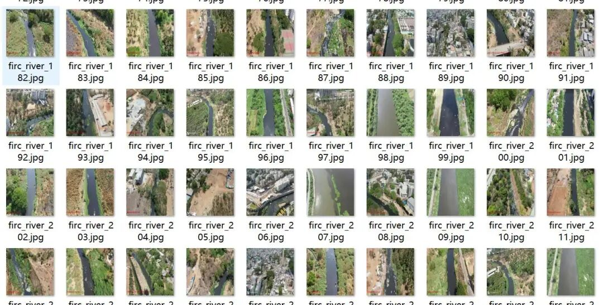
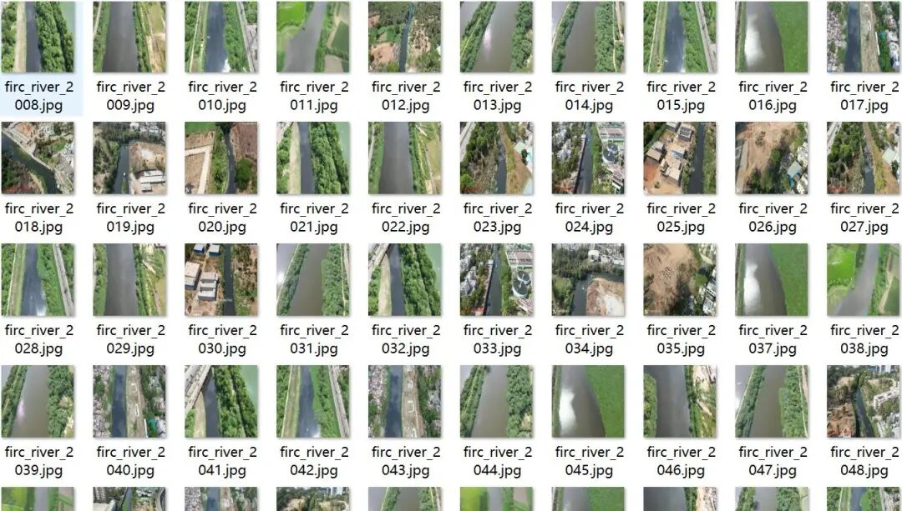
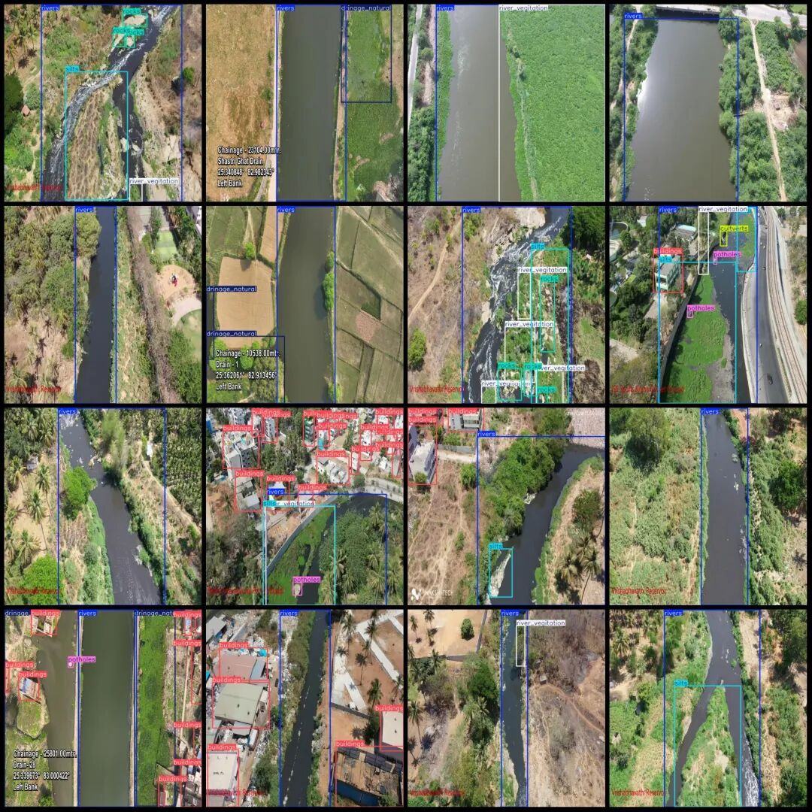
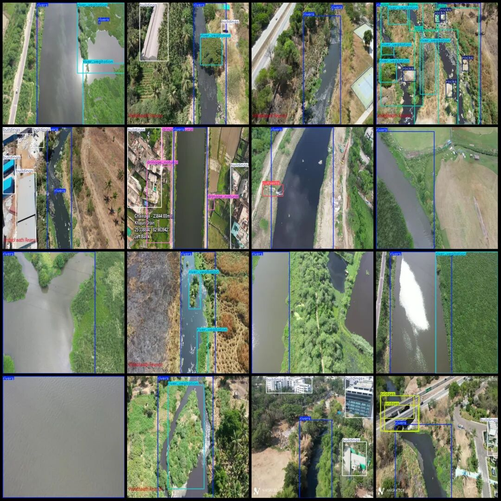

# UAV Viewpoint Aerial Photography River Inspection Vegetation, Mud, and Waste Detection Dataset VOC+YOLO Format with 2777 Images in 12 Categories

Dataset format: Pascal VOC format + YOLO format (txt file without split path, only contains jpg images and corresponding VOC format xml files and yolo format txt files)

Number of images (number of jpg files): 2777

Number of annotations (number of xml files): 2777

Number of annotations (number of txt files): 2777

Label category count: 12

Label category names (note that the order of categories in the YOLO format does not correspond to this, but is based on the classes.txt file in the labels folder): ["bridges", "buildings", "cultverts", "drinage_manmade", "drinage_natural", "obstacles", "potholes", "river_vegitation", "rivers", "rocks", "silts", "trash"]

Number of boxes labeled in each category:

Number of frames = 325

Buildings (Structures) Frame Count = 5928

Cultivated verts (Hole) Number = 50

drinage_manmade (artificial drainage facilities) frame count = 34

drinage_natural (Natural Drainage) Frames = 307

Obstacles (obstacles) Frames = 49

Potholes (ruts) Frame count = 558

river_vegitation (river vegetation) frame count = 1983

rivers (River) Frame count = 3333

Number of rocks (rocks) = 364

Silt (mud) frame count = 596

Trash (Garbage) Frames = 288

Total frame count: 13815

Image resolution: 640x640

Drone: DJI Mavic Pro

Collection height: 100m

Sampling angle: 90°

Using labelImg:

Annotation rules: Draw a rectangle around the category.

Important Notice: No

Special : This dataset does not guarantee the accuracy of the trained models or weight files.

Image Preview:

Annotation example:

## Payment

Here is a pay link on Stripe ( https://buy.stripe.com/3cs8yP7sY87d0vu9AB ). Please contact me lonlonago@foxmail.com after funding $89, and I will send you a complete data files , thank you!

